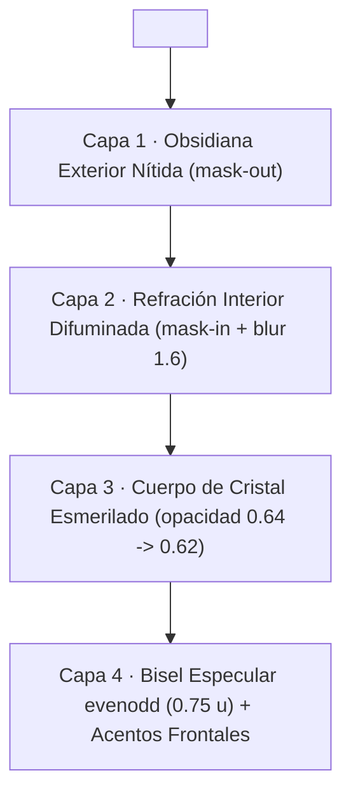

# 01 · Arquitectura Óptica del Estilo Glass (`24×24`)

Este documento describe la receta matemática y óptica exacta empleada en todos los iconos `icons/glass/*.svg` de **IU-SOFT Icons**, asegurando consistencia visual, nitidez sub-píxel y rendimiento predecible.

---

## 1. Principios Innegociables del Lienzo `24×24`

1. **Lienzo canónico:** `viewBox="0 0 24 24"` con área activa contenida entre `2.0 u` y `22.0 u` (margen óptico perimetral de `~2 u`).
2. **Cero trazos `stroke` en estilo Glass:** Ninguna capa del estilo `glass` usa atributos `stroke`. Toda silueta, ranura, reflejo o bisel es un `<path>` cerrado relleno (`fill`), lo que evita artefactos de escalado no uniforme, uniones quebradas en `stroke-linejoin` y discrepancias entre motores de renderizado (Blink, WebKit y Figma).
3. **Contraste garantizado en modo claro y oscuro:** Todo icono `glass` combina al menos dos materiales de luminancia opuesta: **obsidiana oscura** (`#5b5b5e -> #161617`) y **cristal esmerilado translúcido** (`#e3e3e5 -> #bbbbc0`), evitando siluetas lavadas sobre fondos grises claros (`#F4F4F5`) o negros (`#09090B`).

---

## 2. Pipeline Óptico de 4 Capas

Cada icono `glass` se compone de **4 capas ordenadas de atrás hacia adelante**:



### Definiciones `<defs>` exactas

| Recurso SVG | Parámetros exactos | Función óptica |
| :--- | :--- | :--- |
| `#<id>-obs` | `linearGradient` vertical `(12, 2.5) -> (12, 21.5)` `userSpaceOnUse`: `#5b5b5e` (`0%`) a `#161617` (`100%`) | Masa sólida de obsidiana con volumen cenital |
| `#<id>-glass` | `linearGradient` vertical `(12, 2.5) -> (12, 21.5)` `userSpaceOnUse`: `#e3e3e5` (`stop-opacity="0.64"`) a `#bbbbc0` (`stop-opacity="0.62"`) | Cuerpo esmerilado translúcido que deja pasar la sombra refractada |
| `#<id>-bevel` | `linearGradient` vertical `(12, y1) -> (12, y2)` ajustado a la caja del cristal: `#ffffff` (`0.96` en `0%`), `#ffffff` (`0.26` en `58%`), `#ffffff` (`0.0` en `100%`) | Brillo especular superior que se desvanece suavemente hacia la base |
| `#<id>-blur` | `<filter x="-50%" y="-50%" width="200%" height="200%"><feGaussianBlur stdDeviation="1.6"/></filter>` | Dispersión óptica real del objeto trasero al atravesar el cristal |
| `#<id>-out` | `<mask maskUnits="userSpaceOnUse" x="-8" y="-8" width="40" height="40">`: fondo `#ffffff` + silueta del cristal en `#000000` | Recorta con filo quirúrgico la parte de obsidiana que asoma fuera del cristal |
| `#<id>-in` | `<mask maskUnits="userSpaceOnUse" x="-8" y="-8" width="40" height="40">`: fondo `#000000` + silueta del cristal en `#ffffff` | Aísla exclusivamente la porción de obsidiana cubierta por el cristal para aplicarle el desenfoque sin sangrado exterior |

> **Por qué `x="-8" y="-8" width="40" height="40"` en las máscaras:** Cuando el icono se anima con física de resortes (traslación/rotación en hover), un lienzo de máscara de `24×24` recortaría los bordes al rebotar. El margen de `40×40` en `userSpaceOnUse` evita cualquier recorte durante la oscilación.

---

## 3. Ley del Bisel Especular `evenodd` de `0.75 u`

En lugar de usar `stroke-width="0.75"` (que en SVG se dibuja mitad adentro y mitad afuera del camino, ensuciando el borde exterior sobre el `mask-out`), el bisel especular se construye concatenando el **camino exterior del cristal** ($C_{\text{ext}}$) y su **curva paralela desplazada exactamente `-0.75 u` hacia el interior** ($C_{\text{int}}$) en un único `<path>` con `fill-rule="evenodd"`:

```xml
<path d="M ... Z M ... Z" fill="url(#iusoft-pizza-bevel)" fill-rule="evenodd" />
```

- En círculos de radio $R$: $R_{\text{int}} = R - 0.75$.
- En polígonos boleados (`rounded_polygon_path`): en vértices convexos $r_{\text{int}} = r - 0.75$ y en vértices cóncavos $r_{\text{int}} = r + 0.75$, manteniendo un espesor perpendicular constante de `0.75 u` (`1.5 px` al renderizarse a `48×48 px`).
- En el compilador automático (`glass_compiler.py`), dado que el cristal exterior es la isocurva $\text{SDF}_{\text{glass}}(x, y) = 0$, la curva interior exacta sin auto-intersecciones es simplemente la isocurva $\text{SDF}_{\text{glass}}(x, y) = -0.75\text{ u}$ (`-12.0 px` en la rejilla `384×384`).

---

## 4. Física de Resortes Sincronizada con las Máscaras (`60fps`)

Para que la refracción siga siendo físicamente creíble durante la animación en hover:
1. La clase `.iusoft-glass-xf` / `.js-glass-xf` se aplica simultáneamente al `<g>` del panel frontal **y** a los nodos `<g>` dentro de `<mask id="...-out">` y `<mask id="...-in">`.
2. La clase `.iusoft-back-xf` / `.js-back-xf` mueve en sentido opuesto (`+0.35 * pos`) la pieza trasera de obsidiana, creando paralaje real mientras la frontera de refracción se desplaza en tiempo real.
3. Integramos la ecuación diferencial de un oscilador armónico subamortiguado de Hooke:
   $$\ddot{x} = -k x - c \dot{x}, \quad k = 290,\; c = 14.5$$
   con `dt = min(Δt, 0.032s)` para estabilidad numérica y desactivación inmediata cuando `prefers-reduced-motion: reduce` está activo en el sistema operativo.

---

## 5. Presupuesto de Rendimiento GPU en Producción

Cada icono `glass` ejecuta una pasada de `<feGaussianBlur stdDeviation="1.6"/>` y dos máscaras alfa en el compositor del navegador. Aunque en escritorio moderno `200+` iconos renderizan en pocos milisegundos, en **tabletas de mostrador y teléfonos Android de gama media** hacer scroll sobre listas largas con decenas de filtros SVG activos eleva el consumo de memoria de texturas GPU.

### Regla operativa obligatoria

| Superficie en la aplicación | Variante recomendada | Límite por pantalla |
| :--- | :--- | :--- |
| Navegación principal (Sidebar / Bottom Nav / Tabs) | `glass` | `5–10` iconos |
| Tarjetas KPI de cabecera, modales de cobro o estados vacíos | `glass` | `3–6` iconos |
| **Tope simultáneo de `glass` en una vista operativa** | **`glass`** | **Máximo `12–15` iconos** |
| Tablas de ventas, kardex, listas de productos (`50+` filas) o botones secundarios repetidos | `outline` o `duotone` | Sin límite (`0` filtros `feGaussianBlur`) |
| Indicadores compactos `<= 16 px` dentro de badges | `solid` u `outline` | Sin límite (máxima legibilidad a tamaños pequeños) |
